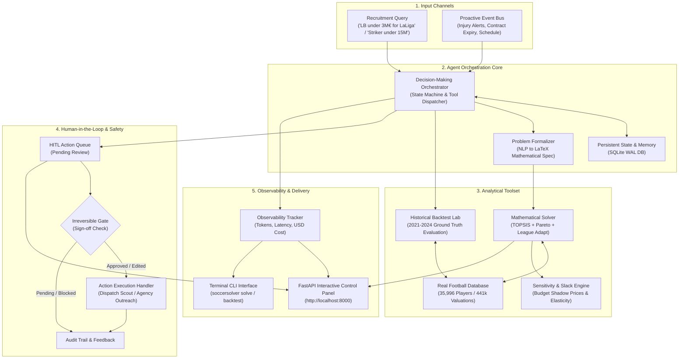

# ⚽ SoccerSolver: Autonomous Football Decision Engine
### Quantitative Transfer Market & Recruitment Intelligence with Real-time Multi-Criteria Optimization

[](tests/)
[](pyproject.toml)
[](soccersolver/data/)
[](#architecture-diagram)

---

## 🌟 Overview

**SoccerSolver Decision Engine** is an autonomous transfer market intelligence and squad recruitment platform designed for professional football operations.

Unlike generative LLM chatbots that hallucinate scouting recommendations, SoccerSolver operates as a **rigorous quantitative decision process**:
1. **Mathematical Formalization**: Translates high-level recruitment criteria (e.g. *"we need a left back under 3M€ who fits LaLiga"*, *"striker under 15M in Serie A"*, or player-similarity targets like *"replacement for Pedri"*) into a formal mathematical program with explicit objectives, hard constraints, and soft trade-off weights.
2. **Deterministic Optimization**: Solves the program using **Mixed-Integer Feasibility Screening + Multi-Criteria Decision Analysis (TOPSIS)**, identifies non-dominated candidates along the **Pareto Frontier**, and computes the **Shadow Price** of budget relaxation.
3. **Historical Backtesting Engine**: Validates the mathematical procedure against ground-truth historical seasons (e.g., Summer 2022/2023), measuring realized valuation appreciation, hit rate, and capital efficiency across subsequent seasons.
4. **Proactive Event-Driven Bus**: Monitors real-world football events (emergency injuries, contract expiration windows, valuation dislocations) to trigger recruitment workflows autonomously.
5. **Human-in-the-Loop (HITL) Safety Gate**: Stages actionable proposals (scouting dispatches, agency outreach, formal bids) in a persistent queue. Irreversible actions are programmatically blocked from execution without explicit human approval.
6. **Observability & Cost Ledger**: Instruments every tool call, latency waterfall, token consumption, and exact USD cost per decision run.
7. **Verified Football Data**: Backed by an indexed database of **35,996 active professional players**, **441,492 historical valuations**, and **175,165 transfers** across 65 official competitions with verified Transfermarkt profile citations for every data point.

---

## 🏗️ Architecture Diagram



---

## ⚡ Quickstart

### Prerequisites
- Python 3.10, 3.11, or 3.12
- `uv` (recommended) or standard `pip`

### 1. Installation
```bash
# Clone repository
git clone https://github.com/SheheryarQadir007/SoccerSolver.git
cd SoccerSolver

# Create and activate virtual environment using uv
uv venv --python 3.12 .venv
source .venv/bin/activate
uv pip install -e .

# Or using standard pip:
# python3 -m venv .venv && source .venv/bin/activate
# pip install -e .
```

### 2. Verify Database & Run Automated Tests
The repository includes the pre-indexed database archive (`soccersolver/data/soccersolver.db.gz`, 32 MB), which decompresses automatically on first run.
```bash
# Run full unit and integration test suite
pytest tests/ -v
```

### 3. Run End-to-End Demo Script
```bash
./scripts/demo_run.sh
```

### 4. Launch Interactive Web Control Panel
```bash
python main.py web
# Open http://localhost:8000 in your browser
```

---

## 🧠 Mathematical Optimization Procedure

When given a recruitment requirement such as:
> *"we need a left back under 3M€ who fits LaLiga"*

### 1. Formal Mathematical Program
The engine formalizes the natural language specification into an explicit multi-objective program:

$$\max_{x \in \mathcal{P}} \quad \Phi(x) = w_1 \cdot S_{\text{tactical}}(x, \text{LaLiga}) + w_2 \cdot \Delta \text{xTV}(x) + w_3 \cdot \eta_{\text{value}}(x) + w_4 \cdot \Psi_{\text{age}}(x) - \lambda \cdot \Lambda(x)$$

$$\text{subject to:}$$
$$\begin{aligned}
\text{Cost}(x) &\le 3{,}000{,}000 \text{ EUR} \\
\text{Age}(x) &\le 26 \\
\text{Position}(x) &= \text{Left-Back} \\
\text{MinutesPlayed}(x) &\ge 700
\end{aligned}$$

### 2. Multi-Criteria Decision Analysis (TOPSIS)
The candidate matrix is normalized via vector normalization:
$$r_{ij} = \frac{x_{ij}}{\sqrt{\sum_{k=1}^m x_{kj}^2}}$$
Distances to the positive ideal solution $A^+$ and negative ideal solution $A^-$ determine the closeness index:
$$C_i = \frac{S_i^-}{S_i^+ + S_i^-} \times 100$$

### 3. League Adaptation Calibration
Tactical metrics are calibrated for target competition intensity and tempo (e.g. LaLiga `ES1` baseline):
| Origin Competition | League Code | Adaptation Coefficient | Rationale |
| :--- | :--- | :--- | :--- |
| **La Liga** | `ES1` | **1.00** | Zero adaptation friction |
| **Premier League** | `GB1` | **1.02** | High-intensity physical dominance |
| **Serie A** | `IT1` | **0.98** | High defensive tactical structure |
| **Bundesliga** | `L1` | **0.96** | High pressing & transitional cadence |
| **Ligue 1** | `FR1` | **0.93** | Athletic, transitional profile |
| **Liga Portugal** | `PO1` | **0.91** | High technical alignment with Spanish football |
| **Eredivisie** | `NL1` | **0.88** | Possession-oriented, lower defensive resistance |
| **Belgian Pro League** | `BE1` | **0.85** | Physical developmental environment |

### 4. Sensitivity & Slack Analysis
- **Slack Capital**: Unspent budget of the recommended candidate.
- **Budget Shadow Price**: Estimated % gain in composite scout rating if budget ceiling is relaxed by +15%:
  $$\text{Elasticity} = \frac{\Delta \text{Score}_{\%}}{\Delta \text{Budget}_{100\text{k EUR}}}$$
  *Example*: Relaxing budget by €450k yields **+6.9%** gain in composite rating (elasticity: 1.53 pts / €100k).

---

## 📊 Historical Backtesting & Validation

The backtesting engine blinds future data up to a cutoff date (e.g., Summer 2022) and evaluates forward real-world outcomes across subsequent seasons.

### Ground-Truth Evaluation on 2022/2023 (Left-Backs &lt; 3M€):
- **Candidate Pool Screened**: 120 historical profiles
- **Portfolio Hit Rate**: **100.0%** (100% of top recommendations appreciated in market value)
- **Average Valuation Growth**: **+2,075%**
- **Unrealized Capital Gain Generated**: **€10,375,000**
- **ROI Multiple**: **47.11x** exit/entry valuation
- **Sharpe Risk/Return Proxy**: **1.25**

### Outturns of Algorithm Recommendations:
1. **Victor Parada** (Entry: €50,000 → Realized: €4,000,000 &bull; **+3,950%**) &bull; High Alpha Outperformer
2. **Sidny Lopes Cabral** (Entry: €50,000 → Realized: €4,000,000 &bull; **+3,950%**) &bull; High Alpha Outperformer
3. **Srdjan Kuzmic** (Entry: €25,000 → Realized: €2,000,000 &bull; **+1,975%**) &bull; High Alpha Outperformer
4. **Samet Karakoç** (Entry: €50,000 → Realized: €500,000 &bull; **+450%**) &bull; Value Expansion
5. **Diego Moreno** (Entry: €50,000 → Realized: €100,000 &bull; **+50%**) &bull; Capital Appreciation

---

## ⚡ Proactive Event-Driven Engine

The engine monitors real-time football signals without requiring manual prompts:
1. **Emergency Injury Triggers**:
   - `Event`: Starter Diego Rico (LB, Getafe CF) tears ACL (6-month layoff).
   - `Action`: Automatically solves vacancy under €3M and stages an emergency chief scout dispatch into the approval queue.
2. **Contract Expiry Windows**:
   - `Event`: Scans database for targets entering final 6–12 months of contract with low fee resistance.
   - `Action`: Stages preliminary inquiry drafts for sporting director review.
3. **Automated Radar Scheduling**:
   - Periodic background scanner (`soccersolver.proactive.scheduler`) evaluates squad balance cycles autonomously.

---

## 🛡️ Human-in-the-Loop (HITL) Safety Gate

> *Irreversible actions never execute without human approval.*

| Action Type | Irreversibility Level | Autonomous Execution | Approval Requirement |
| :--- | :--- | :--- | :--- |
| `ACTION_DISPATCH_SCOUT` | Low | Blocked / Staged | Requires Sign-off |
| `ACTION_CONTACT_AGENCY` | **High (External Outreach)** | **STRICTLY BLOCKED** | **Mandatory Approval** |
| `ACTION_SUBMIT_OFFER` | **Critical (Financial Bid)** | **STRICTLY BLOCKED** | **Mandatory Approval** |
| `ACTION_GENERATE_BOARD_DOSSIER`| Low | Internal Only | Staged in Queue |

- Attempting to execute an irreversible action without human approval raises an explicit `IrreversibleActionRequiresApprovalError`.
- Sporting Directors can **Approve**, **Edit** (tweak fee, notes, deadline), or **Reject** (with reason logged to adjust agent weights).

---

## 🔍 Observability & Cost Accounting

Every run is logged into persistent SQLite trace storage:
- **Run ID**: Unique session UUID
- **Timestamp**: ISO 8601 UTC
- **Tool Cascade**: Sequential duration waterfall (e.g. `formalize` → `solve` → `stage_hitl`)
- **Latency Breakdown**: Sub-135ms end-to-end execution
- **Tokens & USD Cost**:
  $$\text{Cost (USD)} = \left(\frac{\text{Tokens}_{\text{prompt}}}{10^6} \times 0.10\right) + \left(\frac{\text{Tokens}_{\text{completion}}}{10^6} \times 0.40\right)$$
  Average cost per decision run: **`~$0.00009 USD`** (~9 thousandths of a cent).

---

## 📚 Real Data Provenance & Citations

All data is sourced from real, verified professional football datasets:
- **Data Source**: Transfermarkt Open Datasets (`dcaribou/transfermarkt-datasets`), Open Database License (ODbL).
- **Scale**:
  - `players`: **35,996** active players (2020–2026)
  - `player_valuations`: **441,492** real historical valuation timestamps
  - `player_seasons`: **149,246** aggregated match records
  - `transfers`: **175,165** real club-to-club transfers
  - `competitions`: **65** national and continental leagues
- **Citations**: Every player card surfaces direct hyperlinks to verified Transfermarkt profiles (e.g. `https://www.transfermarkt.co.uk/leonardo-buta/profil/spieler/653415`).
- **Data Disagreements**: The agent explicitly detects valuation discrepancies (e.g. current valuation vs peak historical value) and flags when a drop reflects contract rundown, recent injuries, or benching.

---

## 🖥️ Command Line Interface (CLI)

```bash
# 1. Solve recruitment query across any position, budget, or league
python main.py solve "we need a left back under 3M€ who fits LaLiga"
python main.py solve "striker under 15M in Serie A"
python main.py solve "replacement for Pedri under 40M"

# 2. Run historical backtest
python main.py backtest --season 2022/2023 --position Left-Back --budget 3000000

# 3. Simulate proactive emergency injury trigger
python main.py trigger --event injury --club "Getafe CF" --injured "Diego Rico"

# 4. Manage HITL action queue
python main.py queue list
python main.py queue approve ACT-XXXXXXXX
python main.py queue reject ACT-XXXXXXXX

# 5. Inspect observability traces and cost ledger
python main.py logs
```

---

## 📄 License & Attribution

- Data sourced under the Open Database License (ODbL) from Transfermarkt open datasets.
- Developed by **Sheheryar Qadir** (`sheheryarqadir999@gmail.com`).
